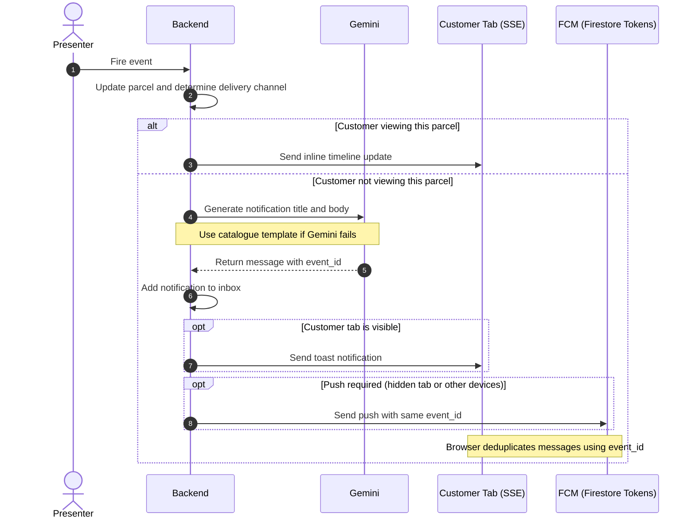

# Shippy notifications demo: "Signals Over Noise"

One delivery event moves through FastAPI, an SSE stream, Gemini and FCM, and lands on the right
surface with the right words.

> Events carry facts. Rules decide who hears about it. AI decides the words.


```
Demo controller ─▶ FastAPI (Cloud Run)
                    POST /api/demo/events ─▶ pipeline
                      1. parcels.apply        (state + timeline)
                      2. router.decide        (pure rules: inline | toast | push | inbox_only)
                      3. enrich               (Gemini, 1.5 s timeout, template fallback; skipped for inline)
                      4. deliver              (SSE to open tabs, FCM push, inbox)
                    GET /api/stream ─────────▶ EventSource (web app + stage inspector)
                    firebase-admin ──────────▶ FCM ─▶ service worker
```

## From event to notification



## Gemini model

`GEMINI_MODEL` picks the model. The default is **`gemini-3.1-flash-lite`**, with thinking turned off
(`GEMINI_THINKING_BUDGET=0`).

| Preference | Model | Why |
|---|---|---|
| 1 (default) | `gemini-3.1-flash-lite` | Answers in about 1 s with thinking off, inside the 1.5 s enrichment budget |
| Not used | Full `gemini-3.x-flash` | Takes about 1.6–2.2 s, so most calls would time out and fall back to templates |
| **Not available** | `gemini-2.5-flash` | Retired for new users: the API returns **404**. Don't set it |

To try a model that rejects a thinking budget of 0 (for example `gemini-3.5-flash-lite`), set
`GEMINI_THINKING_BUDGET=""` so the setting is left out. If there's no API key, the model fails or it
runs past the timeout, the message comes from the catalogue template, so a notification still goes out.

## Layout

| Path | What |
|---|---|
| [backend/app/router.py](backend/app/router.py) | Decision engine. Pure function, table-tested |
| [backend/app/catalogue.py](backend/app/catalogue.py) | Event type → priority, status, fallback templates |
| [backend/app/enrich.py](backend/app/enrich.py) | Gemini call, output validation, cache, fallbacks, kill switches |
| [backend/app/hub.py](backend/app/hub.py) | Connections, presence, replay buffer, inbox (in memory) |
| [backend/app/tokens.py](backend/app/tokens.py) | FCM device tokens: in memory, or Firestore with `TOKEN_STORE=firestore` so they survive restarts |
| [backend/app/pipeline.py](backend/app/pipeline.py) | Event → decision → words → channel, plus burst coalescing |
| [backend/app/fcm.py](backend/app/fcm.py) | firebase-admin web push, stale token cleanup |
| [backend/app/demo.py](backend/app/demo.py) | Scenario endpoints, `X-Demo-Key`, rate limit |
| [web/src/pages/CustomerApp.tsx](web/src/pages/CustomerApp.tsx) | Customer app: Home, Orders, Parcel detail, Payments, toasts, inbox |
| [web/src/pages/StagePage.tsx](web/src/pages/StagePage.tsx) | `/stage`: Demo controller + Channel Inspector (for the projector) |
| [web/public/firebase-messaging-sw.js](web/public/firebase-messaging-sw.js) | FCM service worker (config passed via query string) |

Two personas: **Amani** (`en-KE`) and **Wanjiru** (`sw-KE`, so Gemini answers in Swahili). Stores and people are fictional.

## Run locally

Backend (Python 3.12+):

```bash
cd backend
python -m venv .venv
.venv/Scripts/activate        # Windows; use source .venv/bin/activate on macOS/Linux
pip install -r requirements-dev.txt
cp .env.example .env          # add GEMINI_API_KEY to see Gemini wording; works without it
uvicorn app.main:app --reload --port 8000 --env-file .env.local
pytest                        # routing table, enrichment fallbacks, API, replay
```

Frontend (Node 20+):

```bash
cd web
npm install
cp .env.example .env.local    # Firebase web config + VAPID key for push; works without them
npm run dev                   # http://localhost:5173 (customer), http://localhost:5173/stage (presenter)
```

In dev, Vite proxies `/api` (including the stream) to `:8000`, so there is no CORS.

**Push locally:** the Firebase emulators do not emulate FCM. Use the real project from `localhost`
(service workers are allowed on http://localhost). The backend needs credentials that can send FCM:
`gcloud auth application-default login` plus `FIREBASE_PROJECT_ID`, or `GOOGLE_APPLICATION_CREDENTIALS`
pointing at a service account key with the *Firebase Cloud Messaging Admin* role.


```bash
GEMINI_API_KEY=... pytest tests/test_enrich.py -k golden
```

They assert valid JSON, the length limits, and that every number in the output appears in the input.

## API

`/api/demo/*` requires `X-Demo-Key` when `DEMO_KEY` is set, and is rate limited per IP.

Quick check without the UI:

```bash
curl -N "localhost:8000/api/stream?user_id=u_amani&client_id=curl_tab1" &
curl -X POST localhost:8000/api/demo/events -H 'content-type: application/json' \
  -d '{"type":"parcel.out_for_delivery","user_id":"u_amani"}'
```
Find the API docs at https://shippy-api-yn5hpzfbqq-ew.a.run.app/docs
## Deploy

### Automated (GitHub Actions)

[.github/workflows/deploy.yml](.github/workflows/deploy.yml) runs on every push to `main` (or manually
from the Actions tab). It runs the tests, deploys the API to Cloud Run if `backend/` changed, then builds
and deploys the web app to Hosting if `web/` changed. The SSE URL is looked up from Cloud Run, so
`web/.env.production` is generated in CI and never committed.

One-time setup (Workload Identity Federation, no service account keys in GitHub):

```powershell
gcloud auth login
.\scripts\setup-github-deploy.ps1 -ProjectId shippy-6b185 -Repo <github-user>/<repo-name>
```

The script also creates the `(default)` Firestore database (FCM device tokens, free tier) and grants
the Cloud Run service account access. Deploy the deny-all [firestore.rules](firestore.rules) once with
`npx firebase-tools deploy --only firestore:rules --project <project>`.

Then add the variables and the `DEMO_KEY` secret the script prints under
*Settings → Secrets and variables → Actions*. The jobs use a `production` environment, which GitHub
creates on first run; add required reviewers to it if you want a manual approval before deploys.

### Manual

Prerequisites (plan Phase 0): Firebase project with billing and a budget alert, a registered web app,
a VAPID key, `gemini-api-key` in Secret Manager, and the Cloud Run service account granted
*Firebase Cloud Messaging Admin* and *Secret Manager Secret Accessor*.

1. Set the project in [.firebaserc](.firebaserc) and the region in [firebase.json](firebase.json)
   (it must be a region that Hosting rewrites support; `europe-west1` is the placeholder).

2. Backend → Cloud Run:

   ```bash
   gcloud run deploy shippy-api \
     --source backend \
     --region <region> \
     --allow-unauthenticated \
     --timeout 3600 \
     --max-instances 1 --min-instances 1 \
     --no-cpu-throttling \
     --set-secrets GEMINI_API_KEY=gemini-api-key:latest \
     --set-env-vars "^@^GEMINI_MODEL=<model>@ALLOWED_ORIGIN=https://<site>.web.app,https://<site>.firebaseapp.com@PUBLIC_APP_URL=https://<site>.web.app@DEMO_KEY=<random>@FIREBASE_PROJECT_ID=<project>@TOKEN_STORE=firestore"
   ```

   The `^@^` prefix changes gcloud's list delimiter so `ALLOWED_ORIGIN` can hold a comma.
   `--max-instances 1` is required (state other than FCM tokens is in memory); `--timeout 3600` keeps streams alive;
   `--min-instances 1` avoids a cold start on stage.

3. Frontend → Firebase Hosting. In `web/.env.production` set the Firebase config, the VAPID key, and
   `VITE_STREAM_URL=https://shippy-api-xxxx.<region>.run.app` (SSE goes **directly** to Cloud Run because
   Hosting rewrites cut connections at about 60 s; REST goes through `/api/**` on the same origin).

   ```bash
   cd web && npm run build && cd .. && firebase deploy --only hosting
   ```

4. Open `https://<site>.web.app/stage`, enter the demo key, and test from a phone on mobile data.
